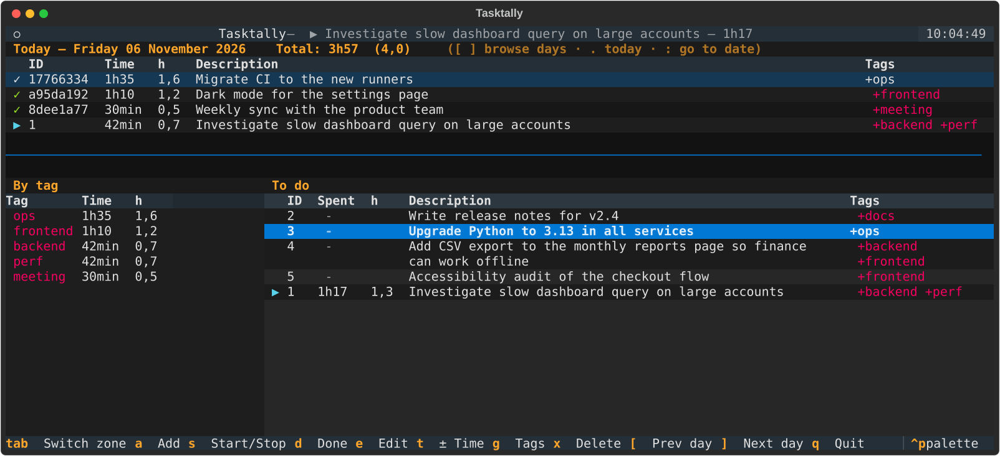

# Tasktally

Daily time tracking on top of [Taskwarrior](https://taskwarrior.org): see how much time you spent on each task, yesterday and today, with totals per tag — from an interactive terminal UI or as a plain text report.



## Features

- **Per-day time**: time is attributed to the day it was spent, so a task started yesterday and finished today shows up in both days with the right amounts.
- **Totals per tag**, in `1h30` and decimal hours (`1,5`) for timesheets.
- **Interactive TUI** to add, start/stop, complete, edit, tag, delete tasks and adjust time.
- **Manual time adjustments** for when you forgot to start the clock.
- Plain Taskwarrior underneath: everything stays usable with the `task` command.

## Installation

On macOS or Linux:

```sh
curl -LsSf https://raw.githubusercontent.com/JeromeM/Tasktally/main/install.sh | sh
```

The script:

1. installs [Taskwarrior](https://taskwarrior.org) if needed — Homebrew on macOS; apt, dnf, pacman, zypper or apk on Linux (may ask for your `sudo` password),
2. installs [uv](https://docs.astral.sh/uv/) if needed, then Tasktally itself,
3. runs `tally setup` to enable `journal.time=on` in `~/.taskrc`, so every start/stop is recorded as a timestamped annotation — this is what Tasktally uses to compute time.

Running it again is safe and updates Tasktally to the latest version.

<details>
<summary>Manual installation</summary>

Requirements: Taskwarrior 2.6+ (tested with 3.x) and uv.

```sh
brew install task uv            # or your distribution's packages
uv tool install git+https://github.com/JeromeM/Tasktally
tally setup
```

Update with `uv tool upgrade tasktally`.
</details>

## Usage

```sh
tally                       # open the interactive view
tally summary               # yesterday, today and the to-do list
tally today                 # text report for today
tally yesterday             # text report for yesterday
tally list status:pending   # list tasks matching any Taskwarrior filter
tally setup                 # enable time tracking in ~/.taskrc (safe to rerun)
tally --help                # all commands and options
```

Shell completion can be enabled with `tally --install-completion`.

For a daily summary (yesterday, today and the to-do list), add an alias to your shell config:

```sh
alias today='tally summary'
```

### Interactive view

| Key | Action |
|---|---|
| `Tab` / `Shift+Tab` | switch between the day view and the to-do list |
| `a` | add a task — `Fix login bug +sentry +urgent` |
| `s` | start / stop the selected task (starting one stops the running one) |
| `d` | mark as done |
| `o` | reopen a completed task |
| `e` | edit the description |
| `t` | add or remove time — `1h30`, `45min`, `-30min` |
| `g` | edit tags — `+infra -aikido` |
| `x` | delete (with confirmation) |
| `y` | toggle today / yesterday |
| `q` | quit |

### Tracking time

The usual flow with Taskwarrior:

```sh
task add +sentry "Fix login bug"   # create
task 5 start                       # start the clock
task 5 stop                        # pause
task 5 done                        # finish (stops the clock)
```

Forgot to start the clock? Add or remove time with an annotation, on any task, even a completed one:

```sh
task 5 annotate "Tracked 1h30"
task 5 annotate "Tracked -30min"
```

Manual time counts for the day the task was completed (or the day of the annotation if the task is still open).

### Reading the reports

| Mark | Meaning |
|---|---|
| `✓` / ✅ | completed that day |
| `▶` / ▶️ | currently running |
| `‖` / ⏸️ | worked on that day, not finished |
| `~1h20` | estimate: the task was never tracked, so its time is creation → completion |

A task with several tags counts in each of them in the per-tag totals.

## License

MIT
